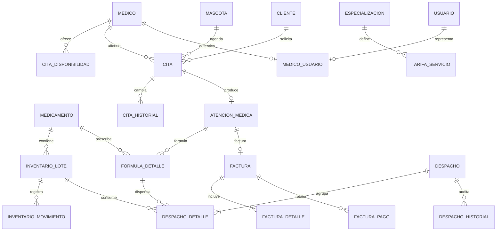

# Backend clínica veterinaria: contratos y migración

## Aplicación local

La base esperada es MySQL 8, esquema `clinica`, servidor en `localhost:3306` por defecto y contexto HTTP `/clinica/v1`. Configure estas variables antes de iniciar:

| Variable | Uso |
| --- | --- |
| `DB_URL` | URL JDBC. Valor local sugerido: `jdbc:mysql://localhost:3306/clinica?serverTimezone=America/Bogota&useSSL=false` |
| `DB_USERNAME` / `DB_PASSWORD` | Credenciales de MySQL |
| `JWT_SECRET` | Clave aleatoria en Base64 de al menos 64 bytes para firmar/verificar HS512 (se lee como `app.jwt.secret`) |
| `SMTP_USERNAME` / `SMTP_PASSWORD` / `SMTP_TO` | Correo saliente; opcional para el resto de operaciones |
| `CLINIC_NAME` / `CLINIC_TAX_ID` / `CLINIC_ADDRESS` / `CLINIC_PHONE` / `CLINIC_EMAIL` | Datos que se congelan en la factura y aparecen en el PDF |

El repositorio deja los perfiles sin credenciales embebidas. No reutilice claves que hayan estado en el repositorio: rótelas antes de desplegar. Las credenciales de base de datos no deben incluirse en commits.

## Migración

`db/migration/V20261117_01__clinica_modulos.sql` es una migración manual aditiva para MySQL 8. Respalde primero la base, confirme que está seleccionada `clinica` y ejecute el archivo una sola vez con un usuario autorizado para `ALTER`, `CREATE`, `UPDATE` e `INSERT`. No cargue de nuevo el dump original. No hay sentencias `DROP`.

La migración agrega columnas al catálogo y a citas, normaliza el código de 8 caracteres para los medicamentos existentes sin sobrescribir códigos presentes y crea tablas para lotes, kardex, importaciones, horarios, historial de citas, atenciones, fórmulas nuevas, tarifas, facturas, pagos y despachos. Los campos antiguos de compra/vencimiento se vuelven opcionales: desde el cambio, la vigencia y el costo de existencias viven en cada lote. El perfil `DESPACHO_MEDICO` se inserta solo si falta.

La migración `V20261117_02__auditoria_factura.sql` agrega auditoría de motivo y usuario para descuentos/anulaciones; ejecútela una vez después de la primera migración. La migración no corrige automáticamente las claves foráneas defectuosas del dump sobre `historia_medica`: estas no se usan para las nuevas atenciones, que se guardan en `atencion_medica`. Es necesario revisar las restricciones de la base real y sus datos antes de corregirlas.

## Modelo



`inventario_lote.cantidad_disponible` se actualiza en la misma transacción que cada fila de `inventario_movimiento`. Los retiros por dispensación usan lotes no vencidos en orden FEFO. `formula_detalle.cantidad_dispensada` permite calcular lo pendiente sin descontar stock al formular.

## Autenticación y roles

Se conserva el JWT que expide `/auth/login` y se verifica el Bearer en el filtro del servidor. `401` indica token ausente, inválido o vencido; `403` indica perfil sin permiso. La clave debe coincidir con `JWT_SECRET`.

| Perfil | Permisos principales |
| --- | --- |
| `ADMINISTRADOR` | Administración existente, catálogo y entradas de inventario |
| `RECEPCION` | Operación existente y citas |
| `MEDICO` | Citas, historia y fórmulas existentes |
| `DESPACHO_MEDICO` | Lectura de inventario y rutas `/despacho/**` |

La asignación de médico a usuario se almacena en `medico_usuario`; el control de propiedad de calendario debe usar esa asociación al exponer rutas de calendario médico.

## Rutas incorporadas

Todas las rutas se prefijan con `/clinica/v1`. Requieren `Authorization: Bearer <JWT>` excepto `/auth/**` y los recursos de Swagger.

| Método y ruta | Acceso | Función |
| --- | --- | --- |
| `GET /medicamento/listar`, `GET /medicamento/{id}` | Perfiles operativos; despacho solo lectura | Catálogo |
| `POST /medicamento/crear`, `PUT /medicamento/{id}` | Administrador | Crear/editar producto; código de 8 caracteres, INVIMA requerido para medicamento |
| `GET /medicamento/stock-bajo`, `/agotados`, `/vencidos`, `/por-vencer?hasta=YYYY-MM-DD` | Perfiles operativos; despacho solo lectura | Alertas calculadas desde lotes |
| `POST /inventario/lotes/entrada` | Administrador | Registrar lote y movimiento de entrada en una transacción |
| `POST /inventario/importaciones/prevalidar` | Administrador | Prevalidar CSV/XLSX y devolver errores por fila; requiere `multipart/form-data` con campo `archivo` |
| `POST /inventario/importaciones/{id}/confirmar` | Administrador | Procesar solo filas válidas, cada fila en transacción aislada y dejar resultado en el log |
| `GET /inventario/productos/{id}/lotes`, `/movimientos` | Perfiles operativos; despacho lectura | Existencias por lote y kardex |
| `GET /inventario/lotes/por-vencer?hasta=YYYY-MM-DD` | Perfiles operativos; despacho lectura | Lotes próximos a vencer |
| `GET /cita/mis-citas?fechaInicio=...&fechaFin=...` | Médico | Consulta solo el calendario asociado al usuario autenticado mediante `medico_usuario` |
| `POST /cita/crear`, `POST /cita/actualizar` | Recepción, médico, administrador | Agenda/actualiza cita de 30 minutos; el médico solo puede operar sobre su propio ID y se registra el cambio de estado |
| `POST /cita/disponibilidad/crear` | Administrador | Gestiona horarios semanales (día ISO 1-7) |
| `GET /cita/disponibilidad/medico?medicoId={id}` | Perfiles operativos | Consulta horarios semanales (día ISO 1-7) |
| `POST /atenciones/finalizar` | Médico, administrador | Finaliza una cita, registra hallazgos y crea fórmulas sin descontar inventario |
| `GET /tarifas/listar`, `GET /tarifas/historial?nombre=...`, `POST /tarifas/crear`, `PUT /tarifas/{id}` | Administrador para cambios; perfiles operativos para lectura | Versiona importes e IVA sin sobrescribir tarifas usadas históricamente |
| `GET /especializacion/listar`, `PATCH /especializacion/{id}/estado` | Perfiles operativos para lectura; administrador para cambiar estado | Consulta y activa/desactiva especialidades |
| `GET /despacho/formulas/pendientes?formulaId=...&mascotaId=...&propietario=...&desde=...&hasta=...` | `DESPACHO_MEDICO` | Busca fórmulas pendientes por ID numérico (se muestra como `FOR-{id}`), mascota, propietario o fecha; incluye cantidades, instrucciones y lotes disponibles |
| `POST /despacho/confirmar` | `DESPACHO_MEDICO` | Confirmación idempotente de entrega FEFO, incluyendo cantidades parciales |
| `GET /despacho/{id}/detalles` | `DESPACHO_MEDICO` | Consulta lotes y cantidades dispensadas |
| `GET /despacho/historial?desde=...&hasta=...&mascotaId=...&propietario=...` | `DESPACHO_MEDICO` | Historial de despachos, lotes, fechas, estados y responsables |
| `POST /despacho/{id}/revertir` | Administrador | Reintegra cantidades, crea movimientos inversos y registra motivo/usuario; no permite repetir reversión |
| `GET /atenciones/contexto/{mascotaId}` | Médico vinculado o administrador | Consulta propietario, citas, historial de estados, atenciones y fórmulas previas/nuevas |
| `GET /atenciones/{id}/pdf` | Médico responsable o administrador | Genera documento PDF de atención y fórmula |
| `POST /facturas/atencion/{atencionId}` | Recepción/administrador; descuento solo administrador | Crea una factura única con valores congelados y medicamentos efectivamente dispensados |
| `POST /facturas/{id}/pagos` | Recepción/administrador | Registra pago parcial/total y actualiza saldo/estado de forma transaccional |
| `POST /facturas/{id}/anular` | Administrador | Conserva factura y registra motivo; no permite anular una factura con pagos sin devolución registrada |
| `GET /facturas/cliente/{id}`, `/mascota/{id}`, `/{id}` | Recepción/administrador | Historial, detalle y pagos |
| `GET /facturas/{id}/pdf` | Recepción/administrador | Descarga factura con snapshots históricos, detalle y pagos |
| `GET /reportes/inventario`, `/reportes/inventario.xlsx` | Administrador | Existencias, valor a costo/venta, agotados, mínimos y vencimientos |
| `GET /reportes/citas?desde=...&hasta=...&medicoId=...`, `/reportes/citas.xlsx` | Administrador | Agenda y conteo de estados por rango y veterinario opcional |
| `GET /reportes/financiero?desde=...&hasta=...`, `/reportes/financiero.xlsx` | Administrador | Facturado, pagos recibidos, servicios/medicamentos, impuestos, descuentos y estados |
| `GET /reportes/{inventario|citas|financiero}.pdf` | Administrador | Exporta reporte PDF; citas/finanzas requieren `desde` y `hasta` |

Swagger UI está en `/swagger-ui/index.html` y OpenAPI en `/v3/api-docs`.

Ejemplo de producto:

```json
{
  "nombre": "Antiparasitario X",
  "descripcion": "Uso veterinario",
  "presentacion": "Tableta 100 mg",
  "tipoProducto": "MEDICAMENTO",
  "registroInvima": "INVIMA-ABC-123",
  "precioCompra": 1200.00,
  "precioVenta": 2500.00,
  "stockMinimo": 10
}
```

Ejemplo de entrada de lote:

```json
{
  "medicamentoId": 42,
  "numeroLote": "L-2026-001",
  "fechaIngreso": "2026-11-17",
  "fechaVencimiento": "2027-11-17",
  "cantidad": 50,
  "precioCompraUnitario": 1200.00,
  "precioVentaUnitario": 2500.00,
  "referenciaProveedor": "OC-9001"
}
```

## Estado de cobertura

El backend incluye servicios y rutas para catálogo/inventario, importación por filas, agenda, contexto/atención/fórmulas, tarifas, despacho FEFO y reversión, facturación/pagos y reportes. Genera PDF de atención, factura y reportes, y XLSX de citas, inventario y finanzas. Los reportes financieros muestran valores facturados y pagos recibidos por separado. Antes de usar las auditorías nuevas de factura, aplique la migración 02. La suite se ejecuta en H2; falta validar los flujos contra la base MySQL local y el cliente Angular.
